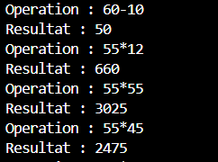

# TP2 DAR — Sockets TCP

Faculté des Sciences de Sfax · LSI3 · Développement d'applications réparties

Ce projet contient deux activités indépendantes. Les calculs sont effectués par le serveur. Chaque serveur utilise le port 5000 : lancer une seule activité à la fois. Java standard suffit, sans bibliothèque externe.

## Activité 2-1 — Échange de chaînes de caractères

Le client lit une expression comme `55 * 25` et l'envoie au serveur par une socket TCP avec `PrintWriter`. Le serveur reçoit la ligne avec `BufferedReader`, effectue le calcul, puis renvoie une chaîne de résultat avec `PrintWriter`. Le client la lit avec `BufferedReader` et l'affiche. La commande `exit` termine la connexion.

Depuis la racine `TP2-DAR2026`, dans le terminal PowerShell de VS Code :

```powershell
javac -encoding UTF-8 -d bin/activite_2_1 src/activite_2.1/Client.java src/activite_2.1/Serveur.java
```

Dans un premier terminal :

```powershell
java -cp bin/activite_2_1 Serveur
```

Dans un second terminal :

```powershell
java -cp bin/activite_2_1 Client
```

Exemple observé : `55 * 25` donne `Resultat : 1375` chez le client et `55 * 25 = 1375` chez le serveur.

## Activité 2-2 — Échange d'objets

`Operation.java` contient les deux entiers et l'opérateur. La classe implémente `Serializable` pour que son objet puisse être transmis par la socket. Le client vérifie la syntaxe, crée un `Operation` et l'envoie avec `ObjectOutputStream.writeObject()`. Le serveur le reçoit avec `ObjectInputStream.readObject()`, effectue le calcul, puis renvoie le résultat sous forme de `String` sérialisée. Le client lit et affiche cette réponse. Les deux côtés créent d'abord leur `ObjectOutputStream`, puis leur `ObjectInputStream`, afin de ne pas se bloquer pendant l'initialisation.

Depuis la racine `TP2-DAR2026` :

```powershell
javac -encoding UTF-8 -d bin/activite_2_2 src/activite_2_2/Operation.java src/activite_2_2/Client.java src/activite_2_2/Serveur.java
```

Dans un premier terminal :

```powershell
java -cp bin/activite_2_2 Serveur
```

Dans un second terminal :

```powershell
java -cp bin/activite_2_2 Client
```

Exemple observé : `7 / 2` donne `Resultat : 3.5`. La commande `exit` ferme la session ; le serveur affiche `Connexion fermee.`.

## Tests réalisés

Les deux activités ont été compilées séparément avec `javac` et exécutées sur `localhost:5000`. Chaque série ci-dessous a été envoyée dans une seule connexion. Les processus client et serveur se sont terminés avec le code 0, sans erreur sur leur sortie d'erreur.

| Entrée | Activité 2-1 | Activité 2-2 |
|---|---|---|
| `55 * 25` | `1375` | `1375` |
| `60*10` | `600` | `600` |
| `20 + 15` | `35` | — |
| `30 - 50` | `-20` | — |
| `10 + 20` | — | `30` |
| `50 - 15` | — | `35` |
| `20 / 4` | `5.0` | `5.0` |
| `7 / 2` | — | `3.5` |
| `-5 * 10` | `-50` | `-50` |
| `10 / 0` | `Erreur : division par zero` | `Erreur : division par zero` |
| `abc + 3` | `Format invalide.` | `Expression invalide.` |
| `25 ** 55` | `Format invalide.` | `Expression invalide.` |
| `exit` | fermeture des deux programmes | fermeture des deux programmes |

Les saisies invalides sont rejetées par le client avant l'envoi. Le journal du serveur montre que les calculs valides sont réalisés de son côté.

## Captures d'écran

Une capture existante de l'activité 2-1 est disponible ci-dessous. Elle montre des calculs dans le terminal ; les captures complémentaires restent à prendre manuellement.



Le dossier `captures/` est prêt pour les captures des deux terminaux de chaque activité : plusieurs opérations, erreur de division par zéro, saisie invalide et fermeture par `exit`. Ajouter les liens aux nouvelles images après les avoir prises.

## Dépôt

Les fichiers `.class` et le dossier `bin/` sont ignorés par Git. Vérifier `git status`, ajouter les captures souhaitées, puis publier dans le dépôt TP2 avant de déposer le lien sur l'ENT.